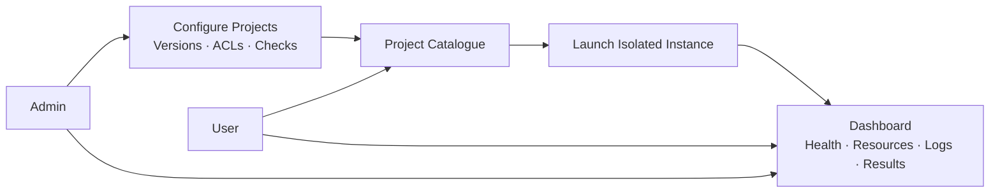

# Nucleus

**Launch. Monitor. Verify.**

A **self-hosted project catalogue**. Admins register containerised projects; users launch selected versions in isolated Docker Compose environments. The host needs Docker with Compose running and compatible container images.

## Use Cases

| Actor | Use cases |
|---|---|
| Admin | Register projects; configure images, dependencies, settings and checks; test and publish versions; archive projects; manage users, teams, ACLs and quotas. |
| User | Browse authorised projects; select a version; launch instances; open applications; start, stop, restart and delete owned instances; run verification. |
| Both | Monitor authorised instances: state, health, CPU/RAM, logs, deployment history and acceptance results. |
| System | Validate configuration; allocate ports; create networks and volumes; collect metrics; execute checks; record audit events; clean up failed deployments. |

**Access control:** RBAC defines admin/user roles. Project ACLs grant users or teams `view` and `launch`; instance ACLs grant `view`, `operate`, `verify` and `delete`. The backend checks permissions on every request. Data deletion is explicit.




# Local setup

1. Download the **Node.js LTS installer (22+)** for your system from [nodejs.org](https://nodejs.org/en/download).
2. Run the installer with the default options (npm is included), then restart your terminal.
3. Check the installation:

   ```sh
   node --version
   npm --version
   ```

4. In the project folder, run:

   ```sh
   npm install
   npm start
   ```
5. Open **http://localhost:8000**. Press **Ctrl+C** to stop.

No build step is needed. If `.env` is missing or `GITHUB_TOKEN` is empty, the graph shows mock data.

To show your own projects:

1. Add a GitHub token to `GITHUB_TOKEN` in `.env`.
2. Give the token access to your projects and list them in `config/repositories.json`.
3. Restart `npm start`.

The app currently shows project data. Monitoring and launching will be added later.
