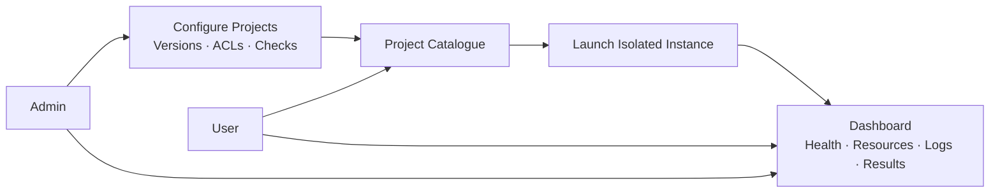

# Nucleus

**Launch. Monitor. Verify.**

A **self-hosted project catalogue**. Admins register containerised projects; users launch selected versions in isolated Docker Compose environments. The host needs Docker with Compose running and compatible container images.

## Use Cases

| Actor | Use cases |
|---|---|
| Admin | Register projects; configure images, dependencies, settings and checks; test and publish versions; archive projects; manage users, teams, ACLs and quotas. |
| User | Browse authorised projects; select a version; launch instances; open applications; start, stop, restart and delete owned instances; run verification. |
| Both | Monitor authorised instances: state, health, CPU/RAM, logs, deployment history and acceptance results. |
| System | Validate configuration; allocate ports; create networks and volumes; collect metrics; execute checks; record audit events; clean up failed deployments. |

**Access control:** RBAC defines admin/user roles. Project ACLs grant users or teams `view` and `launch`; instance ACLs grant `view`, `operate`, `verify` and `delete`. The backend checks permissions on every request. Data deletion is explicit.

Final Claim : automate local deployement for dev of companies or teams members by just shooseing the projects they want from the graph and lunch it

questions could be in the exam : what is your claim , which type it is ? whaty is [type] claim of your project

L05: sodtware lufecycle :
in software dev , we have scope that is the work promised for delivery .

during lifecycle : if the feedback is costing and wast timw and badget u continue what u were doing until finish to deliver the out scope late( same as ur work experience)

the checkout could be external  , or iterative checking , 

sprint is a time slot , it is one week to 4 weeks max where clients and dev meets to updates SAL

we can combine the designs of SDLC and have 