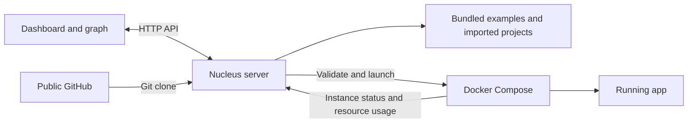

# Nucleus

**Launch. Monitor. Verify.**

A **self-hosted project catalogue**. Admins register containerised projects; users launch selected versions in isolated Docker Compose environments. The host needs Docker with Compose running and compatible container images.


## Run locally

Requirements: Node.js 22.5+. Git is needed to import repositories. Docker with
Compose v2 is needed to launch apps.

```sh
npm install
npm start
```

## How it works



Imported repositories need a supported root Compose file. Review repository
code before launching it; Nucleus rejects configurations outside its safety
checks. The dashboard reports Docker-provided instance status, health, CPU and
memory. No account is required.

Run checks with `npm test` and `npm run test:examples`.
