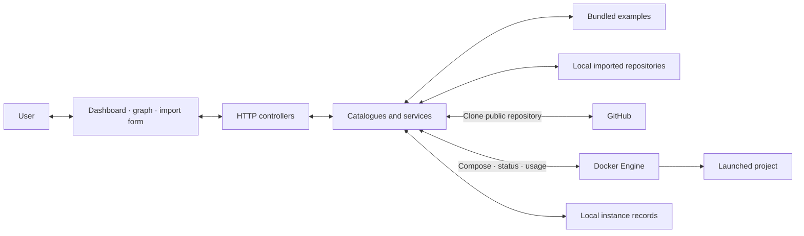

# Nucleus

**Launch. Monitor. Verify.**

A local dashboard to browse four demo projects, import public GitHub
repositories, and launch supported Docker Compose projects from a graph.
Each launch runs in its own isolated Compose project on a loopback port.
Nucleus is local and single-user: it has no accounts or permissions.

## Run

Requires Node.js 22.5+. Git is needed to import repositories. Docker Compose
and a running engine are needed to launch them. The application lives in
`project/`:

```sh
cd project
npm install
npm start
```

Open http://localhost:8000. Browsing works without Docker.

## Architecture



The server binds to loopback. Imported projects need a supported root Compose
file with one `app` service, one TCP port and a healthcheck. Without a Compose
file, a root Dockerfile with one `EXPOSE` port and a `HEALTHCHECK` is enough:
Nucleus generates the Compose file at launch. Review their code before launch. An instance is reported ready only after its health check
passes. Docker status and resource figures are refreshed periodically; they
are not continuous monitoring.

## Checks

```sh
cd project
npm test
npm run test:examples
```

## Project record

- [Checkpoint A: claims, context and evidence](checkpoint-a.md)
- [Checkpoint B: lifecycle and specification](checkpoint-b.md)
- [Checkpoint C: quality evidence](checkpoint-c.md)

