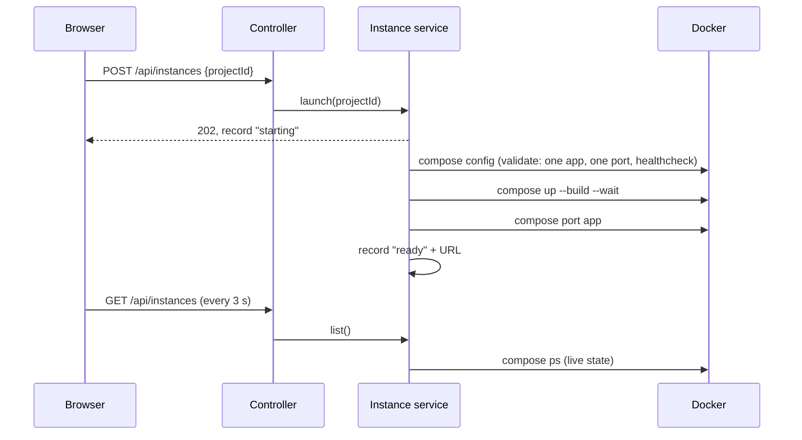

# Checkpoint D — Architecture and changeability

## The view

The context view is in the [README](Readme.md#architecture). Nucleus is one
local Node process on `127.0.0.1`. Docker Engine runs the launched apps;
GitHub is used only to clone public repositories.

| Part | Owns | Code |
|---|---|---|
| Browser UI | dashboard, graph, import form | `project/scripts/` |
| HTTP controllers | local-only checks, routes | `project/controllers/` |
| Instance service | validate, launch, stop, start, remove | `project/services/instances.cjs` |
| Compose generator | Compose from a Dockerfile | `project/services/compose-generator.cjs` |
| Catalogues | examples and imported repositories | `project/models/` |
| Instance records | intent and last message, one per instance | `.nucleus/instances/` |

## One flow: launch a project

## One choice I defend

**Docker decides runtime state, not my records**
([ADR 0002](docs/adr/0002-docker-is-the-source-of-truth.md)). The record can
be stale: a container can crash or be removed outside Nucleus. So every
refresh asks Docker, and "Unknown" is shown when Docker cannot answer.

All decisions: [ADRs](docs/adr/).

## L16 questions

**Q1. What breaks if we remove a component?** Remove the Compose validation
in the instance service, and an imported repository could run privileged,
mount the host or publish on every interface. The cost is low: one function
and its tests. Some valid layouts are refused; that is accepted.

**Q2. Who decides the truth when copies disagree?** Docker, for runtime
state. The record is a copy. If they disagree, the user sees Docker's state
and the record's last message. Only Nucleus writes the record.

**Q3. After a timeout, is retrying safe?**
- **Stop and start: yes.** A repeated start on a running app changes
  nothing and runs the health check again; a repeated stop is refused (`409`)
  with no second effect.
- **Launch: yes, since the fix below.** The browser sends a `requestId` and
  keeps it until the server answers. A retry with the same id returns the
  first instance, also after a Nucleus restart (the id is saved in the
  record). Without it, a retry after a lost answer made a second instance.

**Q4. Can the contract change without changing everyone?** The next change is
the "Inspect and verify" increment, which adds logs. Its consumer is the
dashboard (`scripts/dashboard/instances.js`). New fields are added, never
renamed. A test lists a record written by an older version, so a break shows
before release. I own the contract and the change.

**Q5. How would I discover the design no longer fits?** Promise: "ready" means
the health check passed. Tests falsify it before release (a project without a
health check is refused; a failed start is stopped again). At runtime the
dashboard shows Docker's health next to the state, so "ready" plus
"unhealthy" would reveal a missed case. I investigate; a repeat would make me
check health on every refresh.

## Gap found and fixed

Launch was not idempotent (Q3). Fixed right after this review, before new
features: one `requestId` per launch, tests for a concurrent duplicate, a
retry, a restart and a reused id for another project.
